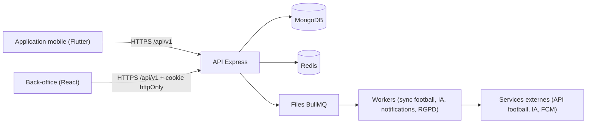
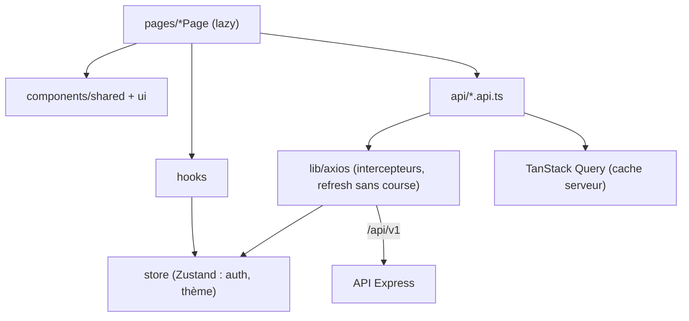

<p align="center"></p>

<h1 align="center">Univers Barça — Back-office d'administration</h1>

<p align="center">Interface web pour gérer le contenu, la modération communautaire, la supervision technique et les comptes.</p>

<p align="center">
  <a href="https://github.com/TheGoatIA/univers_barca_admin/actions/workflows/admin-ci.yml"></a>
  
  
</p>

> Application communautaire **non officielle** pour les supporters du FC Barcelone. Voir [`NOTICE.md`](NOTICE.md) pour les droits d'image et de marque.

## 1. Le produit en bref

**Univers Barça** est une application mobile (iOS / Android) qui rassemble, pour les supporters du FC Barcelone, tout ce qu'ils font autour du club : suivre le calendrier et les matchs, jouer chaque jour (_Guess the Player_, _Quiz adaptatif_), composer une équipe _Fantasy_, découvrir _La Masia_, retrouver d'autres supporters près de chez eux (_carte_ et _groupes locaux_), discuter avec un **assistant IA** borné aux faits, générer des **fonds d'écran IA**, recevoir des **notifications** et suivre sa progression dans le _Culé Passport_.

Le projet est composé de **trois dépôts** qui forment un seul système :

| Dépôt                                                                       | Rôle                                           | Technologie                              |
| --------------------------------------------------------------------------- | ---------------------------------------------- | ---------------------------------------- |
| [`univers_barca_mobile`](https://github.com/TheGoatIA/univers_barca_mobile) | Application des supporters                     | Flutter 3.47.7, BLoC, Chopper, Drift     |
| [`univers_barca_admin`](https://github.com/TheGoatIA/univers_barca_admin)   | Back-office (contenu, modération, supervision) | React 18, Vite, TypeScript, Tailwind     |
| [`univers_barca_api`](https://github.com/TheGoatIA/univers_barca_api)       | API REST, jobs, données                        | Node 22, Express, MongoDB, Redis, BullMQ |



## 2. Ce que fait le back-office

| Section                                   | Rôles autorisés                  | Contenu                                                                          |
| ----------------------------------------- | -------------------------------- | -------------------------------------------------------------------------------- |
| Tableau de bord, recherche globale        | tous                             | KPI, santé de la plateforme, recherche (Ctrl K)                                  |
| Joueurs, matchs et compétitions           | `content-manager`, `super-admin` | CRUD, statuts de publication, traductions, synchronisation football              |
| Contenu éditorial, quiz                   | `content-manager`, `super-admin` | Anecdotes, défis du jour, banque de questions, import CSV                        |
| Modération                                | `moderator`, `super-admin`       | File de signalements, sanctions justifiées, historique, audit                    |
| Utilisateurs                              | `moderator`, `super-admin`       | Recherche, fiche, consentements, RGPD                                            |
| Supervision, comptes admin, configuration | `super-admin`                    | Santé des services, files, quotas IA, comptes et rôles, feature flags, campagnes |

Le cloisonnement par rôle est appliqué **côté client** (`ProtectedRoute allowedRoles`) et **côté API** (RBAC). La connexion utilise un cookie httpOnly pour le refresh, un access token en **mémoire seulement** et le 2FA TOTP.

## 3. Architecture technique



| Brique          | Choix                                                                                                                |
| --------------- | -------------------------------------------------------------------------------------------------------------------- |
| Build / langage | Vite 6, TypeScript strict, alias `@/`                                                                                |
| UI              | React 18, Tailwind (tokens du design system, clair/sombre), primitives Radix (style shadcn/ui), lucide-react, sonner |
| Données         | TanStack Query (serveur), TanStack Table, Zustand (état global léger), axios                                         |
| Formulaires     | React Hook Form + Zod                                                                                                |
| Tests           | Vitest + Testing Library, Playwright (e2e)                                                                           |
| Serveur         | nginx non-root (image Docker), proxy `/api`                                                                          |

## 4. Structure du dépôt

```text
src/
  main.tsx · App.tsx              bootstrap (QueryClient, Toaster, ErrorBoundary) et routeur
  api/        un fichier <domaine>.api.ts par ressource (jamais d'appel HTTP dans un composant)
  components/ auth (ProtectedRoute), layout (Sidebar, Header, MainLayout), shared, ui
  hooks/      useAuth, useDebounced…
  lib/        axios, queryClient, navigation (menu + routes + rôles), utils
  pages/      une page par écran, lazy-loadées
  store/      authStore (persist partiel), uiStore (thème)
  types/      interfaces métier
docker/       nginx.conf (fallback SPA + proxy /api + en-têtes de sécurité), compose staging/production
tests/e2e/    Playwright
docs/         architecture, déploiement, ADR, maquettes (272 captures), pilotage
```

## 5. Démarrage rapide

Prérequis : **Node 22+** et une API démarrée sur `http://localhost:5000` (voir le dépôt API).

```bash
cp .env.example .env
npm ci
npm run dev        # http://localhost:5173 — /api est proxifié vers l'API
```

Connexion : le super-administrateur est créé par `npm run seed` côté API (`ADMIN_BOOTSTRAP_*`).

## 6. Configuration

Les variables `VITE_*` sont injectées **au build** (SPA statique) et visibles dans le bundle : **jamais de secret**.

| Variable                       | Rôle                                     |
| ------------------------------ | ---------------------------------------- |
| `VITE_API_URL`                 | Base de l'API (défaut `/api/v1`)         |
| `VITE_ENV`                     | Étiquette d'environnement                |
| `VITE_DEV_PROXY`               | Cible du proxy de développement          |
| `API_UPSTREAM` (runtime nginx) | Hôte:port de l'API dans le réseau Docker |

## 7. Commandes

| Commande                                                 | Description                                  |
| -------------------------------------------------------- | -------------------------------------------- |
| `npm run dev` · `build` · `preview`                      | Développement · build de production · aperçu |
| `npm run lint` · `format` · `format:check` · `typecheck` | ESLint 9, Prettier, `tsc --noEmit`           |
| `npm test` · `test:coverage` · `test:e2e`                | Vitest, couverture, Playwright               |

## 8. Qualité et sécurité

- **CI** (`admin-ci.yml`) : ESLint, Prettier, types, tests + couverture, build, e2e Playwright, commitlint, build Docker, audit (TruffleHog, Trivy, npm audit).
- **Sécurité** : jeton d'accès jamais persisté, refresh en cookie httpOnly SameSite=Strict, CSP et en-têtes durcis (nginx), rôles vérifiés côté client et serveur, interface en français uniquement.
- **Accessibilité** : labels associés, focus visible, zones tactiles ≥ 44 px, `prefers-reduced-motion`.

## 9. CI/CD et déploiement

| Branche | Environnement | Image Docker                                               | Tag git              |
| ------- | ------------- | ---------------------------------------------------------- | -------------------- |
| `dev`   | staging       | `ghcr.io/thegoatia/univers_barca_admin:staging-AAAAMMJJ.N` | `staging-AAAAMMJJ.N` |
| `main`  | production    | `ghcr.io/thegoatia/univers_barca_admin:prod-AAAAMMJJ.N`    | `vAAAAMMJJ.N`        |

Pipeline `admin-deploy.yml` : vérification → version → image multi-stage (Vite → nginx) → déploiement SSH (health check `/healthz`, rollback) → tag → notification. Sans secrets VPS, seule l'image est publiée. Voir [DEPLOYMENT](docs/DEPLOYMENT.md) et [Déploiement et CI/CD](docs/architecture/04-deploiement-et-cicd.md).

## 10. Documentation

| Document                                                                                                                                | Contenu                                                              |
| --------------------------------------------------------------------------------------------------------------------------------------- | -------------------------------------------------------------------- |
| [Index de la documentation](docs/architecture/README.md)                                                                                | Point d'entrée : par où commencer selon votre rôle                   |
| [Vue d'ensemble de l'architecture](docs/architecture/01-vue-ensemble.md)                                                                | Architecture globale, conteneurs, couches, carte des fonctionnalités |
| [Architecture de données](docs/architecture/02-architecture-donnees.md)                                                                 | Collections, relations, index, Redis, Drift, cycle de vie            |
| [Sécurité et RGPD](docs/architecture/03-securite-et-rgpd.md)                                                                            | Authentification, RBAC, protection des données                       |
| [Déploiement et CI/CD](docs/architecture/04-deploiement-et-cicd.md)                                                                     | Environnements, pipelines, versionnage, rollback                     |
| [Observabilité et qualité](docs/architecture/05-observabilite-et-qualite.md)                                                            | Logs, métriques, tests, charge                                       |
| [Glossaire et conventions](docs/architecture/06-glossaire-et-conventions.md)                                                            | Vocabulaire, conventions de code et de contribution                  |
| [Architectures par fonctionnalité](docs/architecture/features/)                                                                         | 24 documents (flux, données, API, écrans)                            |
| [Plan de réalisation](docs/pilotage/PLAN_REALISATION.md) · [Suivi Excel](docs/pilotage/Univers-Barca-Plan-de-realisation-et-suivi.xlsx) | Étapes, jalons, Gantt                                                |
| [Contribuer](CONTRIBUTING.md) · [Sécurité](SECURITY.md) · [Journal des changements](CHANGELOG.md) · [Décisions (ADR)](docs/adr/)        | Gouvernance du projet                                                |

### Les 24 fonctionnalités

| Réf. | Fonctionnalité                           | Phase | Document d'architecture                                                                                               |
| ---- | ---------------------------------------- | ----- | --------------------------------------------------------------------------------------------------------------------- |
| F01  | Authentification et comptes              | 1     | [F01-authentification-et-comptes.md](docs/architecture/features/F01-authentification-et-comptes.md)                   |
| F02  | Onboarding et personnalisation           | 1     | [F02-onboarding-et-personnalisation.md](docs/architecture/features/F02-onboarding-et-personnalisation.md)             |
| F03  | Paramètres, confidentialité et RGPD      | 1     | [F03-parametres-confidentialite-rgpd.md](docs/architecture/features/F03-parametres-confidentialite-rgpd.md)           |
| F04  | États système et résilience              | 0-1   | [F04-etats-systeme-et-resilience.md](docs/architecture/features/F04-etats-systeme-et-resilience.md)                   |
| F05  | Données football et synchronisation      | 1     | [F05-donnees-football-et-synchronisation.md](docs/architecture/features/F05-donnees-football-et-synchronisation.md)   |
| F06  | Accueil — dashboard                      | 1     | [F06-accueil-dashboard.md](docs/architecture/features/F06-accueil-dashboard.md)                                       |
| F07  | Historique et fiches                     | 1     | [F07-historique-et-fiches.md](docs/architecture/features/F07-historique-et-fiches.md)                                 |
| F08  | Calendrier et export agenda              | 1     | [F08-calendrier-et-export-agenda.md](docs/architecture/features/F08-calendrier-et-export-agenda.md)                   |
| F09  | Guess the Player                         | 1     | [F09-guess-the-player.md](docs/architecture/features/F09-guess-the-player.md)                                         |
| F10  | Quiz adaptatif                           | 1     | [F10-quiz-adaptatif.md](docs/architecture/features/F10-quiz-adaptatif.md)                                             |
| F11  | Comparateur GOAT                         | 2     | [F11-comparateur-goat.md](docs/architecture/features/F11-comparateur-goat.md)                                         |
| F12  | Culé Passport et gamification            | 2     | [F12-passport-et-gamification.md](docs/architecture/features/F12-passport-et-gamification.md)                         |
| F13  | Fantasy Barça                            | 2     | [F13-fantasy-barca.md](docs/architecture/features/F13-fantasy-barca.md)                                               |
| F14  | La Masia Academy                         | 3     | [F14-la-masia-academy.md](docs/architecture/features/F14-la-masia-academy.md)                                         |
| F15  | Carte communautaire                      | 2     | [F15-carte-communautaire.md](docs/architecture/features/F15-carte-communautaire.md)                                   |
| F16  | Groupes locaux                           | 2     | [F16-groupes-locaux.md](docs/architecture/features/F16-groupes-locaux.md)                                             |
| F17  | Modération et sécurité communautaire     | 2     | [F17-moderation-et-securite-communautaire.md](docs/architecture/features/F17-moderation-et-securite-communautaire.md) |
| F18  | Assistant IA Barça AI                    | 1     | [F18-assistant-ia-barca-ai.md](docs/architecture/features/F18-assistant-ia-barca-ai.md)                               |
| F19  | Wallpapers IA                            | 3     | [F19-wallpapers-ia.md](docs/architecture/features/F19-wallpapers-ia.md)                                               |
| F20  | Notifications                            | 1     | [F20-notifications.md](docs/architecture/features/F20-notifications.md)                                               |
| F21  | Back-office : contenu éditorial          | 1     | [F21-backoffice-contenu.md](docs/architecture/features/F21-backoffice-contenu.md)                                     |
| F22  | Back-office : supervision et comptes     | 1     | [F22-backoffice-supervision-et-comptes.md](docs/architecture/features/F22-backoffice-supervision-et-comptes.md)       |
| F23  | Design system et expérience              | 0     | [F23-design-system-et-experience.md](docs/architecture/features/F23-design-system-et-experience.md)                   |
| F24  | Plateforme : jobs, caches, feature flags | 0-1   | [F24-plateforme-jobs-cache-flags.md](docs/architecture/features/F24-plateforme-jobs-cache-flags.md)                   |

## 11. Backlog et organisation du travail

- Le backlog complet est dans les **issues GitHub** de ce dépôt : titre `[CODE] …`, jalon = phase (0 à 3), labels `priorite:*`, `taille:*`, `type:*`, `module:*`. Chaque issue contient contexte, maquettes (clair/sombre), règles de gestion, contrats d'API, tâches, critères d'acceptation et tests à écrire.
- Ordre de traitement : **phase → priorité (P0, P1, P2) → ordre des codes dans l'épopée**, en respectant la section « Dépendances » (qui peut pointer vers un autre dépôt : `API-…`, `MOB-…`, `ADM-…`). Détails dans [`CLAUDE.md`](CLAUDE.md).
- Git : `main` = production, `dev` = intégration/staging, branches `feat/<n°issue>-<slug>` ; commits [Conventional Commits](https://www.conventionalcommits.org/fr/) ; PR vers `dev` avec CI verte.
- Versions de déploiement : `AAAAMMJJ.N` (tags `staging-…` sur `dev`, `v…` sur `main`).
- Un push sur `dev` déploie le **staging** ; un push sur `main` déploie la **production**.

## 12. Licence et droits

Logiciel propriétaire (voir [`LICENSE`](LICENSE)). L'écusson du FC Barcelone utilisé comme logo reste la propriété du club : voir [`NOTICE.md`](NOTICE.md).
