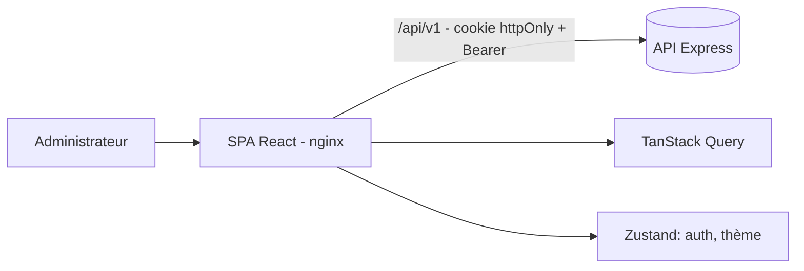
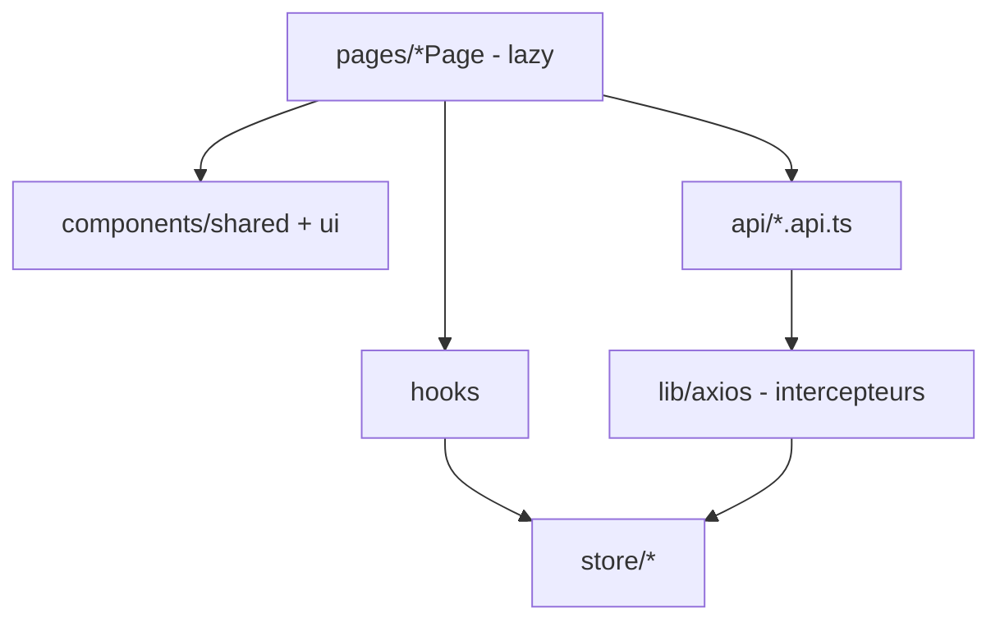
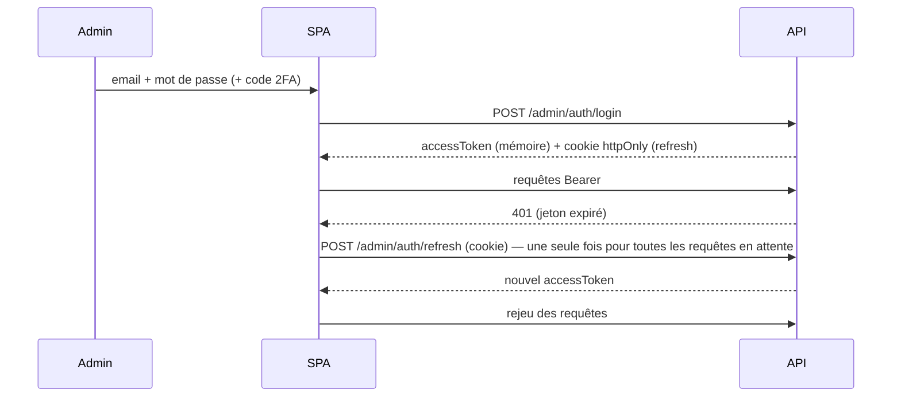

# Architecture du back-office

## Couches

## Authentification

- Le jeton d'accès n'est **jamais persisté** (mémoire uniquement) ; seul le profil l'est (affichage immédiat).
- Échec du refresh → session purgée, redirection `/login`.

## Routage et rôles

`createBrowserRouter` : `/login`, `/403`, puis `ProtectedRoute` (session) → `MainLayout` → `ProtectedRoute allowedRoles` par section (`lib/navigation.ts` est la source unique : menu + routes). Les modules non implémentés affichent `ModulePage` avec la liste des écrans prévus.

## Design system

Tokens CSS (`src/index.css`) identiques à l'application mobile ; Tailwind les expose (`bg-surface`, `text-primary`…). Mode sombre via `[data-theme="dark"]`, préférence persistée (`uiStore`). Polices : Barlow Condensed (titres) et Inter (texte), auto-hébergées (`@fontsource`).

## Données serveur

Format constant `{ success, data }` / pagination `{ items, total, page, totalPages, hasMore }`. Clés de requête : `['players', { q, page }]`. `staleTime` 30 s ; pas de nouvel essai sur les erreurs 4xx.
